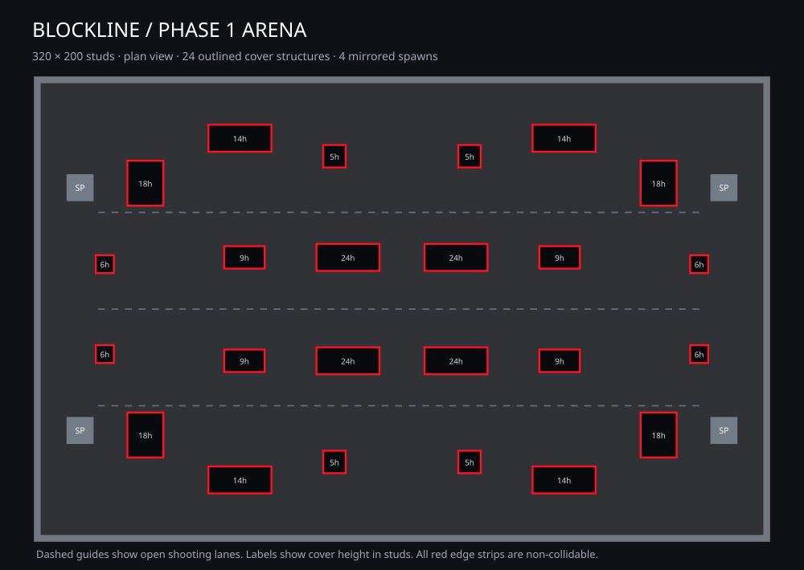

# BLOCKLINE

A native Roblox **ScreenGui introduction and main menu**, connected to a playable minimalist arena and a private aim-training range.

## Download and open

**[Download the project ZIP](https://github.com/TiondreNguyen15-hub/roblox-game-testing/archive/refs/heads/main.zip)** → Extract All → **Roblox Studio → File → Open from File → Blockline.rbxlx** → Play.

- **Blockline.rbxlx**: integrated intro, menu, saved arena and functioning modes.
- **Arena-Phase1.rbxlx**: map-only place with default Roblox movement and no scripts.
- **BlocklineArena.rbxmx**: editable map-only model for inserting into an existing place.

The XML place files are meant to be opened in Roblox Studio. Use the ZIP above if your browser displays XML text instead of downloading a file. Download a new copy to receive updates.

## Phase 0: intro and menu

- Original BLOCKLINE wordmark, real account/asset loading progress, arena background and smooth transition.
- Dark charcoal panels, red accents, hover/focus states, animated page transitions and reduced-motion support.
- PLAY and mode selection enter the current server's actual arena or a private target range.
- Player username, XP-based level, earned credits and server-verified career statistics.
- Current character rendered in a ViewportFrame; equipped weapon preview matches the server Tool's geometry.
- Three working weapons: AR-24, VX-9 and DMR-7. Unlocks cost earned credits; equipping changes the gameplay Tool and its server-side stats.
- Settings: field of view, mouse sensitivity, reduced motion and crosshair visibility.
- Daily reward: 100 credits, server-checked 24-hour cooldown, saved to the account before confirmation.
- Team section displays actual players, teams and modes in this server. Matchmaking joins the current server's balanced team arena; this version has no cross-server queue or party-invite service.
- Responsive mobile layout, native touch buttons, keyboard/mouse controls and controller selection/focus navigation.

### Persistent data setup

Publish a test copy with **File → Publish to Roblox**. For Studio persistence tests, enable **Game Settings → Security → Enable Studio Access to API Services** on that test experience. Published live servers use Roblox DataStoreService.

The server loads profiles before menu access and uses an expiring profile lock, periodic saves and leave/shutdown saves. Settings, credits, XP, statistics, owned weapons and daily cooldown are stored in `Blockline_Profile_v1`.

If cloud data cannot be loaded, the menu clearly shows **session-only data**. Cloud purchases and daily claims are blocked. Settings apply locally, and the save response explicitly reports when they could not be stored. Session fallback data never overwrites an existing cloud profile.

### Controls

| Action | PC | Xbox | PlayStation | Mobile |
|---|---|---|---|---|
| Menu selection | Click | D-pad / left stick + A | D-pad / left stick + Cross | Tap |
| Menu / resume | M or MENU button | Y | Triangle | MENU button |
| Menu back | Click a navigation tab | B | Circle | Tap a navigation tab |
| Fire / aim | Left / right mouse | RT / LT | R2 / L2 | FIRE / AIM |
| Reload / sprint | R / Shift | X / L3 | Square / L3 | RELOAD / RUN |
| Movement / jump | WASD / Space | Default Roblox controls | Default Roblox controls | Default Roblox controls |

### Modes

**Team arena:** two players required, eight-second countdown, five-minute rounds, first team to 30 eliminations. Team damage is disabled. Eliminations grant 50 XP and 20 credits; finishing a match grants 100 XP and 25 credits, plus 50 credits for a win. Abandoned matches do not grant completion rewards. Level increases every 250 XP.

**Practice:** a separate range for each player with three resetting targets and working equipped weapons. Practice does not grant career rewards.

## Phase 1: arena

320 × 200 stud dark-gray rectangular floor. Four enclosed boundaries. Blue sky with clouds. 24 black cover structures with 12 red neon edges each. Cover heights: 5, 6, 9, 14, 18 and 24 studs. Four mirrored neutral spawn pads and three clear shooting lanes. All map parts are saved directly into Workspace and visible before Play.

For the map-only edition, open **Arena-Phase1.rbxlx**. No guns, menu, economy or match scripts are embedded in that file. For an existing place, stop play mode, right-click Workspace → Insert from File → **BlocklineArena.rbxmx**. Remove an older map first to avoid overlapping geometry. The old city model remains in this repository for reference; it is not part of the current arena place.

## Source organization

- `Server.luau` → ServerScriptService / BlocklineServer: profiles, persistence, rewards, mode entry, loadouts and authoritative combat.
- `Client.luau` → StarterPlayer / StarterPlayerScripts / BlocklineMenu: ScreenGui creation, pages, animations, input, previews, intro and gameplay HUD.
- ReplicatedStorage / Blockline: server-created Request RemoteFunction, Event and Combat RemoteEvents, and MatchStatus value.
- Workspace / BlocklineArena: organized floor, boundaries, outlined cover and spawn folders.
- `tools/build_arena.py`: map builder using Python standard library.
- `tools/build_game.py`: packages the scripts into the integrated place and retains a separate map-only place.

Run `python tools/build_game.py` from the repository root to rebuild into `output/`.

## Validation and remaining Studio checks

**Passed in the build environment:** XML structure and unique references; map symmetry, anchored collision bodies, non-colliding red edge strips, spawn clearance, capsule-clear paths connecting all four spawns and three lanes; script syntax; headless tests for profile loading, settings storage, daily cooldown, purchases, owned-equipment checks, real mode transitions, team balancing, practice damage/ammo checks, request failures and profile locks. ScreenGui construction, every page's button wiring, controller bindings and menu/gameplay input switching were exercised with test doubles.

**Not yet verified in Roblox Studio:** actual rendering, avatar appearance, movement/jumping, physics, Roblox cloud storage, multiplayer replication and physical PC/mobile/Xbox/PlayStation input. Roblox Studio is not installed in the build environment. The headless tests do not replace an engine playtest.

See [STUDIO-TESTS.md](STUDIO-TESTS.md) for the engine test checklist. This is an implemented prototype that still needs those live checks; it is not a claim of console certification or production readiness.
