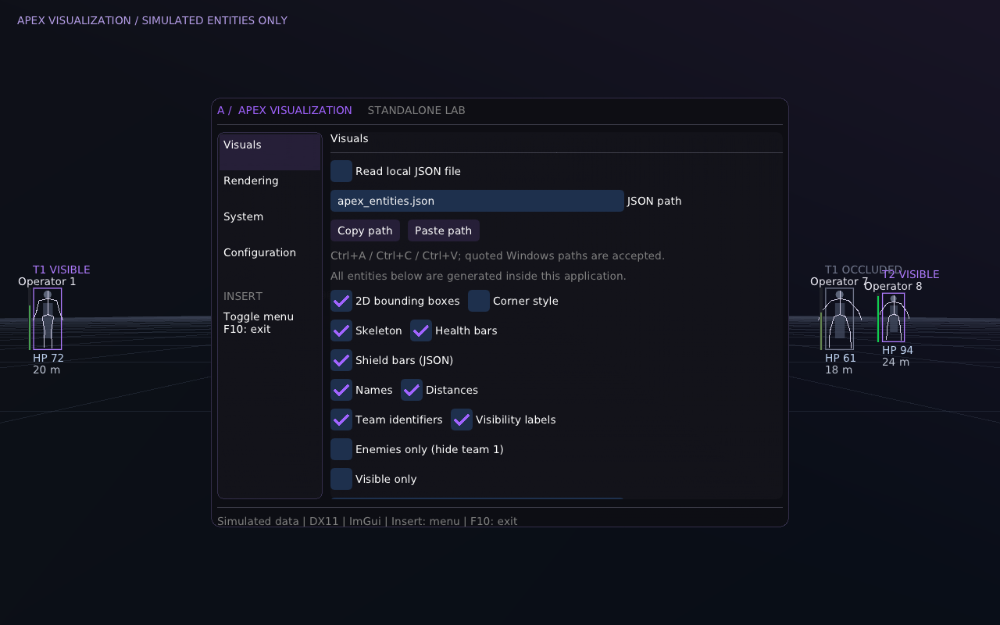

# Apex Visualization — standalone DX11 data lab

See [FINAL-AUDIT.md](FINAL-AUDIT.md) for completed implementation, data-source requirements and hardware acceptance checks.

A modular C++17 Windows desktop application with a dark/purple Dear ImGui interface and animated simulated entities. It draws its own scene inside its own window. No process injection, game hooks, protected-memory access, anti-cheat interaction or live multiplayer manipulation is implemented.



*Documentation preview rendered from real ImGui geometry; not a Windows GPU screenshot.*

## Build with Visual Studio 2022

Install **Visual Studio 2022 → Desktop development with C++**, a Windows 10/11 SDK, and CMake 3.24+. Open this folder in Visual Studio, or run from an x64 Developer PowerShell:

```powershell
cmake --preset vs2022
cmake --build --preset release
ctest --preset release
.\build\vs2022\Release\apex_visualizer.exe
```

Alternative explicit commands:

```powershell
cmake -S . -B build -G "Visual Studio 17 2022" -A x64 -DBUILD_TESTING=ON
cmake --build build --config Release --parallel 2
ctest --test-dir build -C Release --output-on-failure
.\build\Release\apex_visualizer.exe
```

The download ZIP vendors Dear ImGui **v1.91.9b** including its MIT license. A source-only checkout without third_party/imgui fetches the exact official release archive through CMake FetchContent, with SHA-256 verification. nlohmann/json v3.11.3 is vendored for local telemetry. No package manager is required. DX11/Win32 libraries come from the Windows SDK. The included source archive can build offline once VS/SDK/CMake are installed.

## Local JSON input

The app now reads **apex_entities.json** from its working directory by default. The Windows ZIP includes your two-player example. See [JSON-TELEMETRY.md](JSON-TELEMETRY.md) for the exact schema and sample writer. Disable **Read local JSON file** in Visuals to use simulation mode.

## Use

- **Insert** smoothly opens/closes the menu; the simulated scene continues behind it.
- **F5** pauses/resumes; **F6** resets the simulation clock.
- Rendering includes saved playback speed and three training scenes: arena patrol, tracking lanes and static inspection.
- **F10** exits. Resize the window normally; the minimum window size is 640×480.
- Visuals: full/corner boxes, skeletons, health, distances, names, teams and synthetic visibility labels; optional visible-only/enemy-only filters.
- Rendering: animation pause, entity count, distance, VSync, frame cap, menu dimensions and accent color.
- System: measured FPS, application CPU work per frame, normalized process CPU, DXGI adapter name/dedicated memory, uptime and actual ImGui draw/vertex/index statistics.
- Configuration: Save, Load and Restore Defaults. Startup automatically loads an existing file. Invalid files produce an error and do not partially alter settings. Restore Defaults changes memory; Save persists it.

Settings are written atomically to **%LOCALAPPDATA%\ApexVisualization\settings.cfg**. Delete that file to reset the next launch. The application does not silently overwrite a malformed config at startup or write settings automatically on exit.

Team 1 is the simulated local/friendly team. Visibility is generated by the simulation, not read from another application. Health and bone positions animate deterministically from application time. Menu controls affect real rendering/settings fields.

## Architecture

| Module | Responsibility |
|---|---|
| main.cpp | Win32 lifecycle, input, DPI, frame loop, error reporting and backend lifetime |
| renderer.cpp | DX11 device/swap chain/target, resize, present, hardware/WARP fallback and cleanup |
| menu.cpp | Sidebar pages, smooth fade, style and connected settings/config controls |
| visuals.cpp | Perspective projection use, bounded scene drawing, skeleton/box/health/text primitives |
| settings.cpp | Defaults, finite-value checks and range limits |
| config.cpp | Versioned config parsing, error handling and atomic replacement |
| simulation.cpp | Authorized synthetic entity/bone/visibility data and projection math |
| system.cpp | Real process CPU sampling and steady-clock uptime |

Matching headers live under include/apex. No function is a placeholder. Statistics identify what they measure: CPU is this process's share of total logical-core capacity, not whole-machine utilization; GPU information is adapter metadata, not GPU utilization or GPU frame time. Draw statistics describe the previous completed ImGui frame.

## Performance and resource lifetime

Flip-discard presentation with bounded frame latency, asynchronous GPU timing, and one ImGui DX11 submission per frame, CPU-filtered entities capped at 64, reusable entity vector, clipped draw lists, VSync/frame limiting, and minimized/occluded throttling. Camera projection uses a fixed synthetic 70-degree vertical field of view. DX11 queries the actual adapter; WARP is used if hardware creation fails. Device loss/resize/present failures terminate with an HRESULT error instead of continuing with invalid resources.

Window, ImGui backend/context and renderer lifetimes unwind in reverse order, including partial initialization. Swap-chain references are unbound before resize; temporary COM interfaces are released. No external render hooks or other process handles are opened.

## Verification

Portable settings/config/simulation tests and offscreen **real ImGui draw-data** tests are included and can run on Linux using the vendored sources. Windows builds also include those tests. See **VALIDATION.md** for the checks actually performed and remaining Windows runtime checks.

Windows smoke mode creates a real WARP DX11 window, renders six frames, checks nonzero draw data, exits and writes smoke-result.txt:

```powershell
.\build\Release\apex_visualizer.exe --smoke-test
```

`--warp` explicitly selects software rendering; `--frames 120` exits after 120 rendered frames. Normal launch uses hardware with fallback. Errors are recorded in %LOCALAPPDATA%\ApexVisualization\apex.log; normal-mode errors also display a message box.

A GitHub Actions workflow is supplied for Visual Studio builds, CTest and the DX11 WARP smoke test. The Visual Studio 2022 build, all four test suites and the JSON-driven DX11 WARP smoke test passed in [this Windows run](https://github.com/TiondreNguyen15-hub/roblox-game-testing/actions/runs/43356676687). See VALIDATION.md for manual hardware checks still outstanding.
